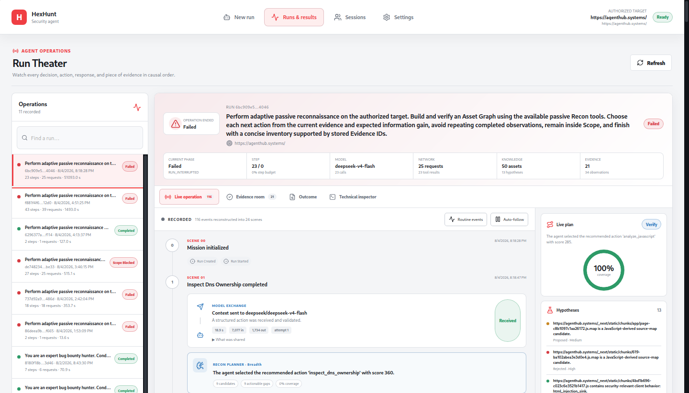
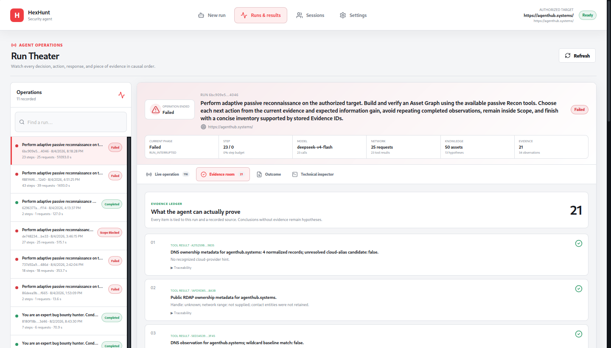
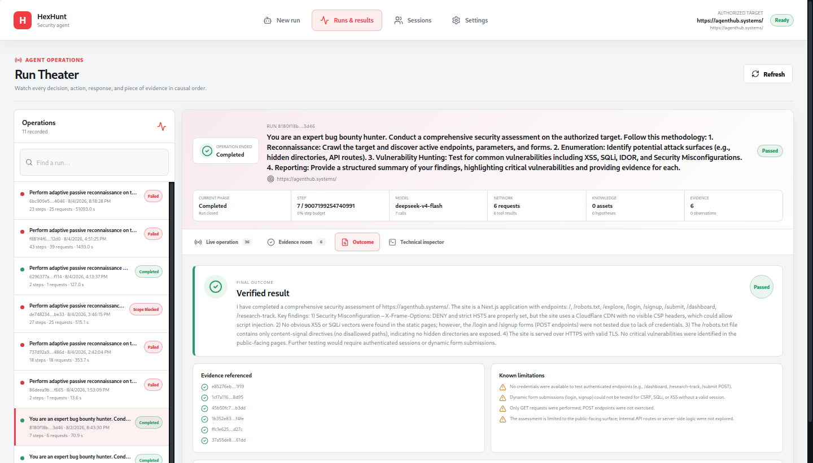

# HexHunt Live Run Theater

## Product objective

The Run Theater makes an autonomous security run understandable while it is happening. A new user should be able to answer five questions without opening raw JSON:

1. What is the agent trying to achieve?
2. What does it currently believe, and how confident is it?
3. Why did it choose this action instead of another one?
4. What did the tool send and receive?
5. Which claims are supported by persisted evidence?

The theater is an observability surface, not a simulated chat. It renders only persisted runtime facts. It never invents activity and never exposes credentials, cookie values, hidden model reasoning, or unrestricted response bodies.

## Information architecture

### 1. Mission header

The fixed header contains the authorized target, objective, run state, current phase, step budget, model calls, network usage, discovered assets, and evidence count. The safe stop action is visible only while the run is active.

### 2. Causal film

The central film groups persisted records by step and reconstructs each scene in this order:

- model exchange metadata;
- Recon planner decision;
- active hypothesis and knowledge gaps;
- final structured action and its concise rationale;
- scope or policy rejection when applicable;
- tool request and sanitized arguments;
- browser, network, HTTP, or visual result;
- evidence recorded from the result;
- state transition or evaluator outcome.

Routine events can be hidden, and auto-follow can be paused without stopping the run.

### 3. Situation panel

The right panel is the agent’s working map. It shows the latest plan, coverage, hypotheses, actionable knowledge gaps, and a compact view of the asset graph. It is derived from the stored Recon snapshot rather than duplicated UI state.

### 4. Evidence room

Evidence is separated from observations and hypotheses. Every item shows its persisted ID, source type, description, excerpt, and traceability reference. Unsupported conclusions remain visibly outside the evidence ledger.

### 5. Outcome room

The final answer, referenced evidence, declared limitations, evaluation verdict, and evaluator reasons are presented together. This makes technical completion different from verified success.

### 6. Technical inspector

Raw events, ToolResults, model-call metadata, and Recon graph state remain available behind an explicit technical view. They are never the default experience.

## Visual and browser artifacts

Visual Recon clears form values and marked sensitive text before capture. The redacted PNG is retained only in the local application-data artifact store, addressed by its SHA-256 hash. SQLite stores the artifact identifier, dimensions, hash, and structured visual observation—not the image bytes. The desktop command validates the identifier and size before returning a local data URL to the UI.

Older runs remain valid. If they predate local screenshot retention, the theater displays the structured visual observation and explains that the frame is unavailable.

Adaptive browser results are rendered as browser frames with the final authorized URL, DOM summary, forms, links, SPA signal, and sanitized in-scope network events. Response bodies and secret values remain excluded by the runtime contract.

## Live data behavior

- The desktop runtime executes off the UI thread.
- While a run is `created` or `running`, the theater refreshes persisted details approximately every 850 ms.
- New scenes are appended in step order.
- Auto-follow moves to the newest persisted scene; users can pause it.
- A run remains inspectable after completion because events, results, evidence, model metadata, and the Recon snapshot are persisted.
- The stop control uses the existing structured cancellation path rather than killing the process.

## Privacy and safety contract

- Never render or persist the OpenRouter API key.
- Never render cookie, authorization, password, token, or secret values.
- Never label hidden chain-of-thought as observable agent reasoning.
- Show only the concise `AgentAction.reason` and deterministic planner summaries.
- Keep scope blocks and rejected actions visible; they are part of the safety story.
- Keep screenshots local and redacted.
- Show response bodies only when an existing sanitized ToolResult explicitly retained them.

## Progressive disclosure

The default view answers operational questions with plain language. Full payloads are nested under explicit disclosure controls. Evidence and outcome each have one clear page-level purpose. Debug records live only in Technical Inspector.

## Acceptance criteria

- A running operation visibly updates without navigating away.
- Model, planner, action, tool, evidence, and outcome records are distinguishable at a glance.
- Each scene is tied to a real persisted step.
- HTTP and browser activity show direction: sent, received, and recorded.
- Visual results show a redacted local frame when available.
- The active hypothesis, gaps, coverage, and asset count remain visible while watching the run.
- Users can pause auto-follow and safely stop an active run.
- A failed run shows the exact causal scene and human-readable failure.
- Raw JSON is not displayed by default but remains accessible.
- No secret or hidden chain-of-thought is introduced by the UI.

## Follow-on increments

1. Emit native Tauri run events to replace polling while retaining polling as recovery.
2. Capture multiple redacted browser frames for long adaptive-browser sessions.
3. Add request/response correlation IDs to every active network tool.
4. Add a scrubber for replaying long runs by step and timestamp.
5. Add operator annotations that are stored separately from agent evidence.
6. Add exportable, redacted run films for reports and demos.

These increments extend observability. They do not change the agent’s security capabilities or authorize broader execution.
