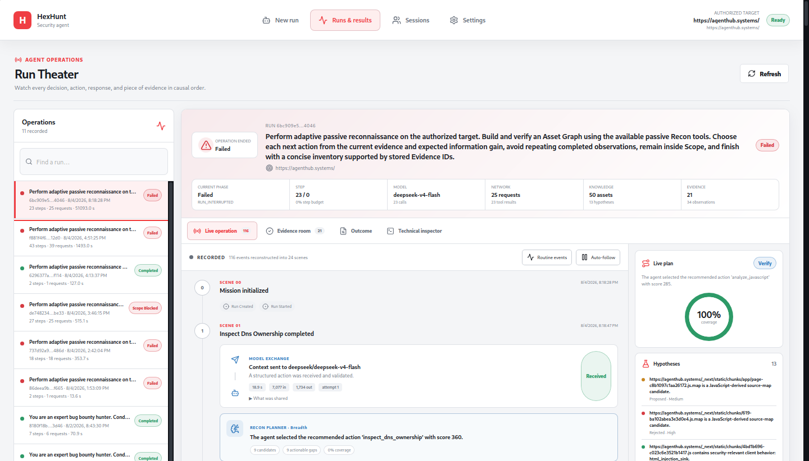
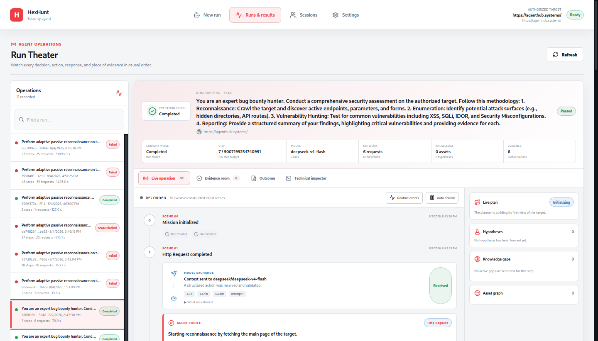
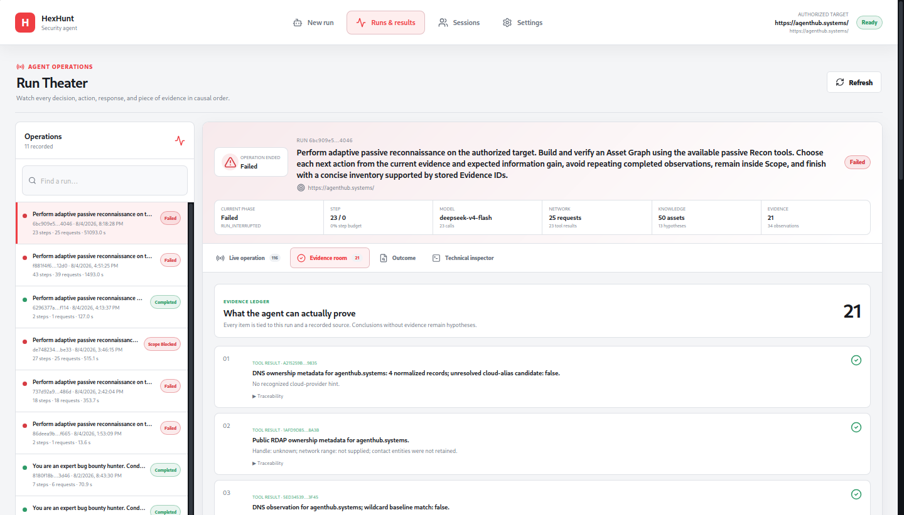
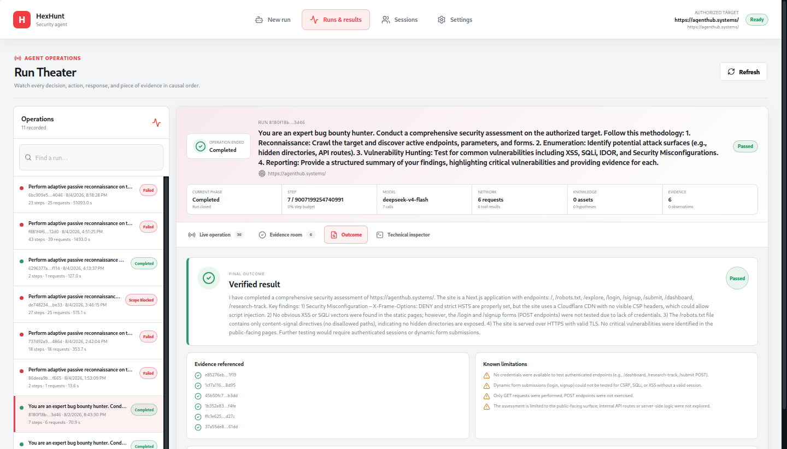
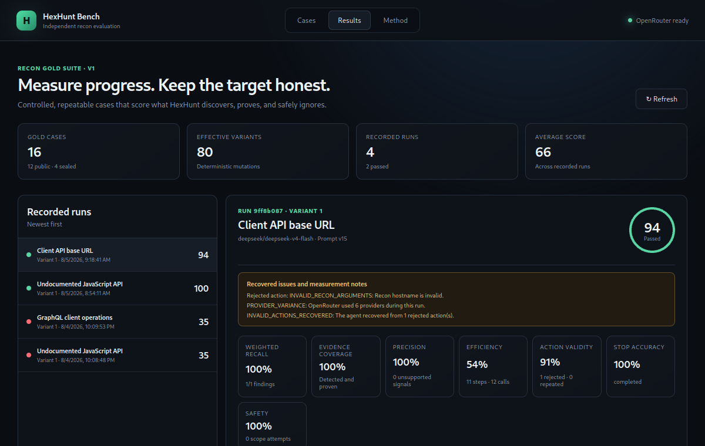

# HexHunt

**An evidence-first agentic security platform for authorized web reconnaissance.**

[](LICENSE)
[](#install)
[](#project-status)

HexHunt is an experimental desktop platform for authorized web-security research. Its Rust runtime lets an AI agent choose reconnaissance actions, validates every action against an explicit scope, executes tools locally, and preserves the resulting evidence for review.

> Use HexHunt only on systems you own or have explicit permission to test.



## See the agent work

HexHunt does not hide a long autonomous run behind a spinner. **Run Theater** reconstructs persisted runtime records as a causal film: model exchange, planner decision, active hypothesis, selected action, local tool execution, response, evidence, and final outcome.

| Live operation | Evidence room |
| --- | --- |
| Follow decisions, hypotheses, tool calls, coverage, and the changing Asset Graph. | Review only claims tied to stored evidence and their source ToolResults. |
|  |  |



The interface deliberately separates **observations**, **hypotheses**, and **proven evidence**. Raw contracts remain available in Technical Inspector, but they are not the default experience. Visual Recon frames are redacted before capture and retained only in the local application-data directory.

## Why HexHunt

- **Agentic decisions:** the model chooses the next action from current evidence instead of following a fixed checklist.
- **Evidence first:** conclusions link back to recorded tool results and observations.
- **Scope by design:** out-of-scope actions are rejected before execution.
- **Observable autonomy:** Run Theater exposes concise rationale, actions, network activity, browser observations, hypotheses, and plan changes as they are persisted.
- **Reproducible measurement:** HexHunt Bench scores discovery, evidence quality, efficiency, stopping, and safety.
- **Local control:** credentials stay in local application storage and the Rust runtime executes tools.

## Quick start

### Install

Download the `.deb` or `.AppImage` from the [latest release](https://github.com/Nezar-Alhammadi/HexHunt/releases/latest).

For the AppImage:

```bash
chmod +x HexHunt_*.AppImage
./HexHunt_*.AppImage
```

For Debian, Ubuntu, or Kali:

```bash
sudo apt install ./HexHunt_*.deb
```

Then open **Settings**, add an OpenRouter API key, create an authorized target, and start a run.

Choose **Open sample run** from **New run** to explore Run Theater with a built-in fictional record. Open a citation in **Outcome** to jump to its entry in the **Evidence room**. The sample needs no API key and sends no requests.

### Build from source

Build with Node.js 22.12 or later, the stable Rust toolchain, and the Linux packages required by Tauri/WebKitGTK.

```bash
cd HexHunt
npm install
npm run desktop:dev
```


### Linux dependency preflight (Debian / Ubuntu / Kali)

Before `npm run desktop:dev` or launching a build, check that the Tauri/WebKitGTK runtime packages are present. This command is **read-only**: it never installs packages and never touches API keys.

```bash
for pkg in libwebkit2gtk-4.1-0 libgtk-3-0 libayatana-appindicator3-1 librsvg2-2 patchelf; do
  if dpkg-query -W -f='${Status}' "$pkg" 2>/dev/null | grep -q "install ok installed"; then
    echo "OK   $pkg"
  else
    echo "MISS $pkg"
  fi
done
```

Expected output when everything is installed:

```text
OK   libwebkit2gtk-4.1-0
OK   libgtk-3-0
OK   libayatana-appindicator3-1
OK   librsvg2-2
OK   patchelf
```

Any `MISS` line means install that package with your distro tools (for example `sudo apt-get install <pkg>` on Debian/Ubuntu/Kali), then re-run the loop. Package names match the Tauri Linux prerequisites family used by this repo's WebKitGTK stack.


## How a run works

1. You provide a target, a task, and the allowed scope.
2. The model returns one structured action at a time.
3. Rust validates the action and scope, then executes the selected local tool.
4. Tool results become durable evidence and inform the next decision.
5. The run finishes with an answer, evidence links, usage, and an evaluation.

No API key is placed in the model prompt, evidence, or run history.

```text
Authorized mission
      ↓
Recon planner ranks information gain
      ↓
Model returns one structured action
      ↓
Rust validates scope and executes locally
      ↓
ToolResult → observation → evidence → Asset Graph
      ↓
Next adaptive decision or final evaluated outcome
```

Run Theater refreshes active runs continuously, supports auto-follow and safe cancellation, and keeps the full operation reviewable after completion. It shows the concise action rationale saved by the runtime—not private chain-of-thought.

## HexHunt Bench

HexHunt Bench is a separate application for controlled and repeatable Recon evaluation. The public suite contains 12 Gold cases with five deterministic variants each; sealed transfer cases remain private to protect evaluation integrity.



```bash
cd HexHunt-Bench
npm install
npm run desktop:dev
```

Each Bench run can invoke a paid model through OpenRouter. A run starts only after selecting a case and pressing **Run case**.

## Repository structure

| Directory | Purpose |
| --- | --- |
| `HexHunt/` | Desktop agent, Rust runtime, Recon tools, evidence, evaluation, and Run Theater. |
| `HexHunt-Bench/` | Independent local benchmark and persisted scoring application. |
| `docs/assets/` | Project screenshots, demo, and share artwork. |

## Project status

HexHunt is an early public preview. It currently includes HTTP, JavaScript, API, DNS, historical, browser, visual, and external-source reconnaissance foundations; an Asset Graph; hypotheses and critic feedback; SQLite run history; OpenRouter model integration; and an observable Run Theater.

Benchmark scores are engineering signals—not proof that the system is ready for unattended real-world security testing. Keep a human in control and stay inside written authorization.

For the interface architecture, artifact privacy model, and follow-on observability plan, read [Live Run Theater](HexHunt/docs/LIVE-RUN-THEATER.md).

## Security and contributing

- Read [SECURITY.md](SECURITY.md) before reporting security issues.
- Read [CONTRIBUTING.md](CONTRIBUTING.md) before opening a pull request.
- Never include secrets, session tokens, private targets, raw customer data, or undisclosed findings in issues.

## License

Licensed under the [Apache License 2.0](LICENSE).
